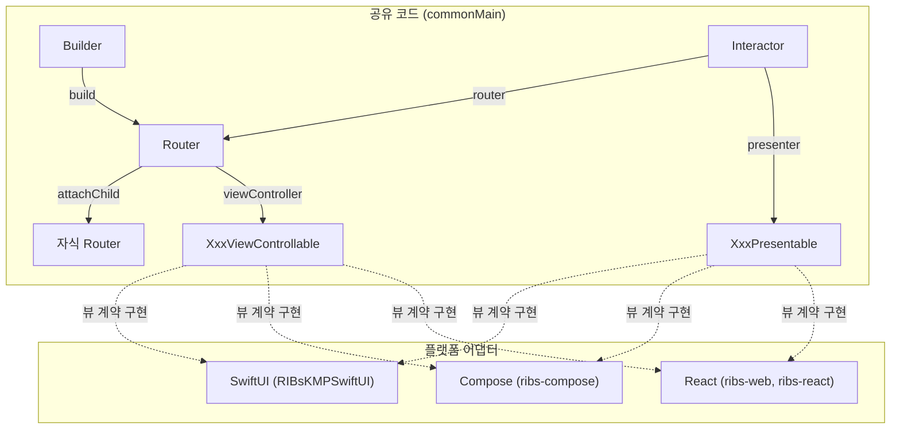

# carti-RIBs-KMP

[](LICENSE.txt)
[](gradle/libs.versions.toml)


Uber RIBs(Router-Interactor-Builder) 아키텍처를 Kotlin Multiplatform 공유 코드로 옮긴 프레임워크입니다.
[uber/RIBs-iOS](https://github.com/uber/RIBs-iOS)의 이름과 생명주기 순서를 따릅니다([ADR-0010](docs/adr/ADR-0010-uber-ribs-ios-as-reference.md)).

- 비동기: Rx 없이 코루틴/Flow
- DI: Dagger 없이 수동 `Component` / `Dependency`
- View: 공유 코드는 뷰 계약 인터페이스만 알고, 화면은 플랫폼 어댑터가 맡음

## 구조



Interactor는 `XxxPresentable`만, Router는 `XxxViewControllable`만 받고, 플랫폼 뷰가 둘을 함께 구현합니다. 자세한 규칙은 [아키텍처 규칙](docs/architecture.md)에 있습니다.

## 요구 사항

| 항목 | 버전 |
|---|---|
| Kotlin | 2.3.21 (coroutines 1.10.2) |
| JDK (빌드) | 17 이상 (Android Studio 내장 JBR 가능) |
| Android | minSdk 24 |
| iOS / macOS | `iosArm64`, `iosSimulatorArm64`, `macosArm64`. Swift 어댑터는 iOS 17 / macOS 14 이상 |
| 웹 | Kotlin/JS (브라우저, Node.js) |

iOS/macOS 빌드는 Mac에서만 가능합니다. 아직 Maven·SPM으로 배포하지 않아 소스를 받아 빌드해서 씁니다.

## 빌드와 검증

```bash
./gradlew :ribs-core:check             # 테스트 + 공개 API 검사 + 공유 코드 규칙 검사
./gradlew :ribs-core:updateKotlinAbi   # 공개 API를 의도적으로 바꿨을 때 덤프 갱신
```

Android 타깃은 SDK 경로(`local.properties`의 `sdk.dir` 또는 `ANDROID_HOME`)가 필요합니다. Apple 타깃은 Mac에서만 빌드·테스트됩니다.

## 샘플

같은 로그인 → 할 일 목록 → 상세 RIB 트리(`samples/login-shared`)를 세 플랫폼에서 그립니다.

| 플랫폼 | 위치 | 어댑터 |
|---|---|---|
| iOS (SwiftUI) | [samples/ios-login](samples/ios-login/README.md) | `swift/RIBsKMPSwiftUI` |
| Android (Compose) | [samples/android-login](samples/android-login/README.md) | `ribs-compose` |
| 웹 (React) | [samples/web-login](samples/web-login/README.md) | `ribs-web`, `react/ribs-react` |

실행 방법과 구조는 각 샘플의 README에 있습니다.

## RIB 만들기

```bash
./gradlew newRib -Pname=Profile -Ppackage=com.example.profile -PkotlinDir=shared/src/commonMain/kotlin \
  -PswiftDir=ios/Sources -PswiftModule=Shared -PcomposeDir=android/src/main/kotlin -PcomposePackage=com.example.android
```

공유 코드 RIB, 테스트, SwiftUI·Compose 화면 뼈대를 만듭니다. 이미 있는 파일은 덮어쓰지 않습니다. Claude Code에서는 `create-rib` 스킬이 이 태스크를 호출한 뒤 내용을 채웁니다.

완성된 예시는 [SampleRibs.kt](ribs-core/src/commonTest/kotlin/com/carti/ribs/sample/SampleRibs.kt)와 `samples/login-shared`에 있습니다.

## 문서

- [아키텍처 규칙](docs/architecture.md)
- [원본 대비 파일 비교](docs/upstream-comparison.md)
- [ADR 목록](docs/adr/README.md)
- [작업 규칙](AGENTS.md)

## 라이선스

[uber/RIBs](https://github.com/uber/RIBs)(Copyright (c) 2017 Uber Technologies)의 설계와 API를 바탕으로 다시 구현한 파생 프로젝트이며, Apache License 2.0으로 배포합니다. 전문은 [LICENSE.txt](LICENSE.txt)를 참고하세요. Uber의 공식 프로젝트가 아닙니다.
